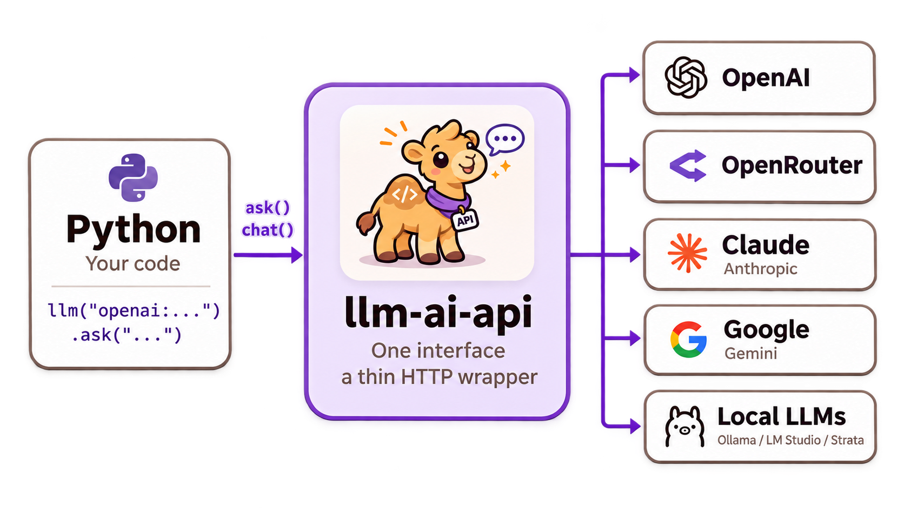

# llm-ai-api

[](https://pypi.org/project/llm-ai-api/)

**どの LLM も、同じ書き方で。**
OpenAI / OpenRouter / Claude (Anthropic) / Google の API と、Ollama / LM Studio / Strata のローカル LLM を、同じ `ask()` / `chat()` で呼び出せる薄い HTTP ラッパーです。公式 SDK は使わず、依存は `httpx` のみです。

[English](README.md) | [チュートリアル](docs/tutorial-ja.md) | [ドキュメント一覧](docs/README-ja.md)

<p align="center">
  
</p>

## 特長

- **切り替えはモデル名だけ**: OpenAI、Claude、Gemini、OpenRouter からローカル LLM まで、同じ書き方で呼べます
- **モデルのクセは吸収**: 送ると拒否されるパラメータは自動で省きます。回避コードは要りません
- **キャッシュとログを内蔵**: 同じ質問に二重に課金されないキャッシュと、入出力の記録が標準で付いています
- **依存は最小限**: 公式 SDK は使いません。依存は httpx だけで、軽く入ります

## インストール

Python 3.10 以降が必要です。

```sh
pip install llm-ai-api
```

## クイックスタート

```python
from llm_ai_api import llm

luna = llm("openai:gpt-6-luna")
print(luna.ask("可愛い犬の名前を考えて"))
```

API キーは環境変数で渡します。モデルは `"<プロバイダー>:<モデル名>"` で指定します。

| プロバイダー | 指定の例 | API キーの環境変数 |
|---|---|---|
| `openai` | `openai:gpt-6-luna` | `OPENAI_API_KEY` |
| `openrouter` | `openrouter:anthropic/claude-sonnet-5.5` | `OPENROUTER_API_KEY` |
| `grok` | `grok:grok-4.7` | `XAI_API_KEY` |
| `anthropic`（別名 `claude`） | `claude:claude-sonnet-5-5` | `ANTHROPIC_API_KEY` |
| `google` | `google:gemini-3.8-flash` | `GEMINI_API_KEY`（または `GOOGLE_API_KEY`） |
| `muse` | `muse:muse-wonder-1.0` | `MODEL_API_KEY` |
| `lmstudio` | `lmstudio:<モデル名>` | `LMSTUDIO_API_KEY`（認証が必要な構成のみ） |
| `ollama` | `ollama:<モデル名>` | `OLLAMA_API_KEY`（認証が必要な構成のみ） |
| `strata` | `strata:<モデル名>` | `STRATA_API_KEY`（認証が必要な構成のみ） |

- API キーの取得方法は、[API キーの取得方法](docs/api-keys-ja.md) にプロバイダーごとにまとめています
- ローカル LLM の接続先は、`lmstudio` が `http://localhost:1234/v1`、`ollama` が `http://localhost:11434/v1`、`strata` が `http://127.0.0.1:47831/v1` です。設定と LAN 越しの接続は各ページを参照してください（[LM Studio](docs/local_llm-lmstudio-ja.md) / [Ollama](docs/local_llm-ollama-ja.md) / [Strata](docs/local_llm-strata-ja.md)）
- Google Gemini は、Google の OpenAI 互換エンドポイント経由で呼び出します
- 代表的なモデルは定数でも指定できます（中身は `"プロバイダー:モデル"` の文字列です）。載っていないモデルも文字列でそのまま使えます

```python
from llm_ai_api import llm, models

m = llm(models.ANTHROPIC_CLAUDE_OPUS_5_5)
```

最初から順に試す手順は[チュートリアル](docs/tutorial-ja.md)を参照してください。

## 使い方

### 主なメソッド

| メソッド | メソッド(async) | 説明 |
|---|---|---|
| `ask(質問)` | `aask(質問)` | LLMからテキストの応答を得る |
| `ask_stream(質問)` | `aask_stream(質問)` | LLMからの応答をストリームで得る |
| `chat(会話履歴)` | `achat(会話履歴)` | LLMに会話を与えて応答を得る |
| `chat_stream(会話履歴)` | `achat_stream(会話履歴)` | LLMに会話を与えて応答をストリームで得る |

全メソッドの一覧は [API リファレンス](docs/api-ja.md) を参照してください。

### ストリーミングとチャット

```python
# ストリーミング
for piece in luna.ask_stream("短い物語を書いて"):
    print(piece, end="", flush=True)

# 会話履歴の利用
result = luna.chat([{"role": "user", "content": "こんにちは"}])  # ChatResult: text, stop_reason, usage, raw, request_id, latency, retries

# messages を渡すストリーミング
for piece in luna.chat_stream([{"role": "user", "content": "こんにちは"}]):
    print(piece, end="", flush=True)

# 履歴を使ったチャットアプリ
history = []
while True:
    user_text = input("あなた: ")
    if not user_text:
        break
    history.append({"role": "user", "content": user_text})
    stream = luna.ask_stream(history)
    print("request_id:", stream.request_id)
    pieces = []
    for piece in stream:
        print(piece, end="", flush=True)
        pieces.append(piece)
    history.append({"role": "assistant", "content": "".join(pieces)})
```

- `ask()` と `ask_stream()` には、質問の文字列ではなく、空でないメッセージ辞書のリストも渡せます（非同期の `aask()` / `aask_stream()` も同じ）。履歴は呼び出し側で管理し、`system=` は `chat()` と同じく先頭に追加されます。ストリームのイテレーターには `request_id` も設定されます
- 旧名の `stream()`（非同期は `astream()`）は非推奨です。`ask_stream()`（非同期は `aask_stream()`）の別名として残してあります
- ストリームは、最後まで読むか、捨てられたときに自動で接続を閉じます（非同期では、ストリームを作ったイベントループがまだ動いている場合に限ります）。途中でやめるときは `close()`（非同期では `await stream.aclose()`）を呼ぶと、すぐに接続を解放できます

### パラメータの扱い

- 指定していないパラメータは送りません（新しいモデルは `temperature` などをデフォルト値でも拒否することがあるため）
- 公式仕様で拒否されると確認したパラメータは、明示しても、`extra` で渡しても送りません（例: Claude の API バージョン `2026-10-21` では `temperature` / `top_p` / `top_k`。OpenAI の `gpt-6-astra` など、一部のモデルでは `temperature` も）。表にないモデルとパラメータ、および OpenRouter、Google、Grok、Muse はそのまま送ります
- 落とすキーをそのまま送りたいときは、生レイヤー `luna.client.request(path, body)` を使います（こちらはボディを加工しません）。それ以外のパラメータは `extra={...}` で渡せます

### タイムアウトとリトライ

```python
m = llm("openai:gpt-6-luna", timeout=60, max_retries=2, retry_read_timeout=False, retry_after_max=60)
m.set_config(max_retries=0)  # 生成後に変更する（渡した引数だけが変わる。非同期にも反映）
```

- 既定では、接続段階の失敗（サーバーに届いていないもの）と HTTP 408 / 409 / 429 / 5xx だけをリトライします。読み取りタイムアウトなど送信後の失敗は、二重課金を避けるためリトライしません（`retry_read_timeout=True` で読み取りタイムアウトもリトライします）
- `retry_after_max` は `retry-after` ヘッダーに従って待つ秒数の上限です
- 設定の一覧と本番環境での推奨は、[設定リファレンス](docs/config-ja.md) を参照してください

#### 呼び出しごとのタイムアウト

`ask()` / `chat()` / `ask_stream()` / `chat_stream()`（非同期も同じ）は、キーワード引数 `timeout`（秒）でその呼び出しだけタイムアウトを変えられます。省略（`None`）するとクライアントの設定（既定 600 秒）を使います。

```python
text = luna.ask("短い質問", timeout=30)
```

これは **操作ごとのタイムアウト** で、合計の期限ではありません（ストリームでは「次のデータが届くまでの時間」）。リトライ（既定 2 回）の分だけ全体の時間は延びます。この引数だけでは、同期コードで合計の期限を保証できません（データが届くたびに待ち時間がリセットされるため、`max_retries=0` にしても、特にストリームや少しずつ返る応答では全体の時間に上限がありません）。非同期コードで厳密な期限が必要なときは、`aask_stream()` の呼び出しだけではなく、ストリームを読み切る処理全体のコルーチンを `asyncio.wait_for()` で包んでください（通信は最初の反復で始まるため）。

### 呼び出しの結果とイベント

`chat()` / `achat()` の `ChatResult` には、応答ボディ（`raw`）とは別に `request_id`、`latency`（秒）、`retries` が入ります。`ask()` はテキストだけです。リトライや失敗は入出力ログには残らないので、`add_event_listener` で受け取ります。

```python
luna.add_event_listener("retry", lambda event, payload: print(event, payload.get("request_id")))
result = luna.chat([{"role": "user", "content": "こんにちは"}])
print(result.request_id, result.retries, result.latency)
```

イベントの一覧、payload のキー、`request_id` の参照先（`ChatResult`、`ChatChunk`、ストリームのイテレータ、例外、`request()`）は、[イベント](docs/events-ja.md) を参照してください。

### 非同期（async）

同じ `llm()` で、メソッド名の先頭に `a` を付けると非同期で使えます（`aask()` / `achat()` / `aask_stream()` / `achat_stream()`）。

```python
import asyncio
from llm_ai_api import llm

async def main():
    async with llm("openai:gpt-6-luna") as m:
        print(await m.aask("可愛い犬の名前を考えて"))

        async for piece in m.aask_stream("短い物語を書いて"):  # await は付けない
            print(piece, end="", flush=True)

        # 同じ LLM で並行に呼び出せる
        answers = await asyncio.gather(m.aask("犬の名前を1つ"), m.aask("猫の名前を1つ"))
        print(answers)

asyncio.run(main())
```

- `aask_stream()` / `achat_stream()` は最初の反復で通信を始めるため、接続エラーや HTTP エラーも最初の反復（`async for` の開始時）に発生します（同期版の `ask_stream()` / `chat_stream()` は呼び出し時に発生します）。途中でやめるときは `await stream.aclose()` を呼んでください
- `async with`（または `await m.aclose()`）で閉じてください。閉じた後は再利用できません
- イベントループをまたいで使わないでください。`asyncio.run()` のたびに新しい `llm()` を作ります
- 非同期コード（FastAPI のハンドラーなど、イベントループの中）で同期版の `ask()` / `chat()` / `ask_stream()` / `chat_stream()` を呼ばないでください。リクエストが終わるまでイベントループ全体が止まります。`aask()` / `achat()` / `aask_stream()` / `achat_stream()` を使います
- `close()` が閉じるのは同期クライアントだけで、非同期クライアントは閉じません。非同期 API を使った場合は `await m.aclose()`（または `async with`）で、非同期・同期の両方を閉じます

キャッシュとログは非同期でも同期版と同じように働きます。非同期に対応しているのは共通インターフェイス（`llm()`）だけで、プロバイダークライアントや生レイヤー（`request()`）の非同期版はありません。

接続の使い回しと終了処理については、[チュートリアルの「使い回しと後片付け」](docs/tutorial-ja.md#9-使い回しと後片付け) を参照してください。

## キャッシュとログ

### API応答のキャッシュ

デフォルトではオフです。オンにすると、同じプロバイダー・モデル・リクエスト（メッセージとパラメータ）で再び呼び出したとき、API を呼ばずに保存済みの結果を返します。

```python
from llm_ai_api import llm, set_cache

set_cache("cache.db")                    # プロセス全体でオン（SQLite ファイルのパス）
m = llm("openai:gpt-6-luna")              # グローバル設定を使う
m2 = llm("openai:gpt-6-luna", cache="other.db")  # インスタンスごとの指定
m3 = llm("openai:gpt-6-luna", cache=False)       # このインスタンスだけオフ
```

- `cache=True` は既定のファイル `llm_ai_api_cache.db` を使います。`SQLiteCache` オブジェクトを渡すこともできます
- 環境変数 `LLM_AI_API_CACHE_DIR` にディレクトリを指定すると、`set_cache()` を呼ばなくても `<ディレクトリ>/cache.db` でオンになります
- ストリーミング（`ask_stream()` / `chat_stream()` / `stream_chat()`）もキャッシュされます（終端イベントまで読み切ったときだけ保存）
- 保存される応答は、API キーから作った鍵で暗号化されます。キーは `{プロバイダー}:{モデル}@{APIキー}>>>{入力}` のハッシュなので、API キーが違えば別のキャッシュになります
- 古いエントリは `clear_cache(days)` で削除できます（`clear_cache(0)` で全削除）。ファイルサイズが `max_size`（既定 100 MB。`set_cache(..., max_size=None)` で無制限）を超えると、古いほうから 1/3 の行が自動で削除されます
- キャッシュが有効な間は、同じリクエストには常に同じ保存済みの応答が返ります。新しい応答が欲しい場合は、キャッシュを空にするかオフにしてください。ファイルを新規作成するときは、所有者のみがアクセスできる権限（0600）になります

詳しくは、[キャッシュ](docs/io_cache-ja.md) を参照してください。プロバイダー側のプロンプトキャッシュについては、[プロンプトキャッシュ](docs/cache-ja.md) を参照してください。

### 入出力のログ

デフォルトではオフです。オンにすると、`ask()` / `chat()` / `ask_stream()` / `chat_stream()` / `stream_chat()` の呼び出しごとに、入力（リクエストボディ）と出力（生の応答）を JSON Lines 形式で 1 行ずつ追記します。

```python
from llm_ai_api import llm, set_log

set_log("llm_log.jsonl")                       # プロセス全体でオン
m = llm("openai:gpt-6-luna", log="other.jsonl")  # インスタンスごとの指定
m2 = llm("openai:gpt-6-luna", log=False)         # このインスタンスだけオフ
```

- 環境変数 `LLM_AI_API_LOG_DIR` にディレクトリを指定すると、`<ディレクトリ>/llm.jsonl` でオンになります
- 1 行には `time`, `provider`, `model`, `stream`, `cached`, `request`, `response` が入ります。API キーは記録されません
- ログは平文で、プロンプトと回答がそのまま入るので、取り扱いに注意してください。`JSONLLog(..., redact=hook)` で記録を加工・省略できます
- POSIX では書き込み前にファイル権限を `0600` にします。ストリーミングは最後まで読み切ったときだけ記録されます
- ファイルサイズが `max_size`（既定 100 MB。`set_log(..., max_size=None)` で無制限）を超えると、古いほうから 1/3 の行が自動で削除されます

詳しくは、[入出力のログ](docs/io_logs-ja.md) を参照してください。

## 接続設定

同時接続数やプロキシ、TLS のような接続まわりの設定は、`set_connection()` でプロセス全体に、`connection=` でインスタンスごとに指定できます。

```python
from llm_ai_api import llm, set_connection

set_connection(max_connections=50, proxy="http://proxy.example:8080")  # プロセス全体
m = llm("openai:gpt-6-luna", connection={"max_connections": 5})        # このインスタンスだけ差分
```

指定できるのは `max_connections`（既定 100）、`max_keepalive_connections`（既定 20）、`keepalive_expiry`（秒、既定 5.0）、`connect_timeout`（秒、既定 10.0）、`verify`（bool または CA のパス、既定 True）、`cert`（証明書のパスまたは組）、`proxy`（http/https の URL）です。設定はクライアント生成時に解決され、後から `set_connection()` を呼んでも既存のインスタンスには影響しません。`set_connection()` は置き換え式で、引数なしで呼ぶと既定に戻ります。

ヘッダー名は大文字・小文字を区別せず、クライアントとリクエストごとのヘッダーが先の値を上書きします。優先順位は[設定リファレンス](docs/config-ja.md)を参照してください。

## エラーメッセージ

エラーメッセージは日本語と英語に対応しています。言語は環境変数 `LLM_AI_API_LANG`、`LANGUAGE` / `LC_ALL` / `LC_MESSAGES` / `LANG` の順に判定し、判定できなければ英語です。明示的に指定することもできます。

```python
from llm_ai_api import llm, set_language

set_language("ja")                       # プロセス全体
m = llm("openai:gpt-6-luna", lang="en")  # モデルごと
```

`set_language()` はプロセス全体の設定です。他のスレッドや、すでに作成済みのインスタンスが例外を出すときのメッセージの言語も変わります（生成時に設定を解決する `set_cache()` / `set_log()` とは異なります）。インスタンスごとに言語を変えたいときは `lang=` を使ってください。

すべての例外は、言語に依存しない `code`（例: `"missing_api_key"`）を持っています。メッセージの文面ではなく `code` で判定してください。API 自身が返したメッセージは翻訳しません。

## セキュリティ上の注意

次の点は、ライブラリ側では意図的に制限していません。アプリで渡す値には注意してください。

- **`base_url`**: スキームやホストの制限はありません。`http://` の外部ホストにも API キーとリクエスト本文が送られます。信頼できる値だけを渡し、利用者入力をそのまま渡さないでください。ホスト系の API では HTTPS を使ってください（[設定リファレンス](docs/config-ja.md)）
- **画像・音声**: `images=` と `transcribe()` のパスは、サイズ上限なく全量読み込みます（`bytes` はすでにメモリ上にあります）。画像はさらに base64 と JSON で、元のサイズの約 1.3 倍以上のメモリを使います。アプリ側でサイズを確認し、信頼できないパスやアップロードをそのまま渡さないでください（[画像入力](docs/multimodal-ja.md)）
- **ローカルプロバイダー**（`lmstudio` / `ollama` / `strata`）: 既定では固定ポートの平文 HTTP に接続し、サーバーの真正性は確認しません。共有マシンでは、同じポートの別プロセスがプロンプトを受け取れることがあります。認証付きプロキシやトークンは接続先の真正性を確かめるものではないので、機密情報を扱うときは各ページの注意も読んでください（[LM Studio](docs/local_llm-lmstudio-ja.md#注意点)、[Ollama](docs/local_llm-ollama-ja.md#注意点)、[Strata](docs/local_llm-strata-ja.md#注意点)）
- **推移依存パッケージ**: 現在の `pip install` では修正済みバージョンがすでに解決されます。他のパッケージが古い推移依存を固定している環境では、`httpcore>=1.0.9`（`h11>=0.16.0` を要求）、`anyio>=4.14.2`、`certifi>=2026.10.18`、`idna>=3.15` を推奨します。

## サンプル

[`examples/`](examples/) を参照してください。多くのスクリプトは、引数 `プロバイダー:モデル`（または環境変数 `LLM_MODEL`）でモデルを指定します。`local-llm-*.py` はモデル名だけを受け取り（環境変数 `LMSTUDIO_MODEL` / `OLLAMA_MODEL` / `STRATA_MODEL` でも指定できます）、それぞれのローカルサーバーが起動していることを前提とします。

| スクリプト | 内容 |
|---|---|
| `hello.py` | 挨拶を返してもらう |
| `hello_stream.py` | ストリーミングで返信を表示する |
| `hello_async.py` | `asyncio.run` と `async with` で `aask()` と `aask_stream()` を使う |
| `ask.py` | 引数で指定した任意のモデルで `ask()` と `ask_stream()` を試す |
| `chat_history.py` | チャット履歴に基づいて返信する |
| `ocr_test.py` | 画像に書かれた文字を読み取る |
| `image_desc.py` | 画像の内容を説明してもらう |
| `models_test.py` | `models` の定数を使い、2 つのモデル（GPT-6 Luna と Claude Haiku）に朝食のメニューについて意見交換してもらう（両方の API キーが必要） |
| `cache_demo.py` | 同じ質問を 2 回して、2 回目がキャッシュから返ることを確かめる |
| `local-llm-lmstudio.py` | ローカルの LM Studio サーバーで `ask()` / `chat()` / `ask_stream()` を試す（[docs/local_llm-lmstudio-ja.md](docs/local_llm-lmstudio-ja.md)） |
| `local-llm-ollama.py` | ローカルの Ollama サーバーで `ask()` / `chat()` / `ask_stream()` を試す（[docs/local_llm-ollama-ja.md](docs/local_llm-ollama-ja.md)） |
| `local-llm-strata.py` | ローカルの Strata サーバーで `ask()` / `chat()` / `ask_stream()` を試す（[docs/local_llm-strata-ja.md](docs/local_llm-strata-ja.md)） |

`ask(prompt, images=[...])` は、画像（ファイルのパス・bytes・http(s) の URL）をプロバイダーごとの形式に組み立てて送ります（[docs/multimodal-ja.md](docs/multimodal-ja.md)）。`chat()` に渡す `content` のネイティブ dict はプロバイダー間で変換されません。

## ドキュメント

- [チュートリアル](docs/tutorial-ja.md): 最初から順に試す手順
- [API リファレンス](docs/api-ja.md): 全メソッドの一覧
- [設定リファレンス](docs/config-ja.md): 設定の一覧と本番環境での推奨
- [ドキュメント一覧](docs/README-ja.md): すべてのドキュメントへのリンク

## ライセンス

MIT
